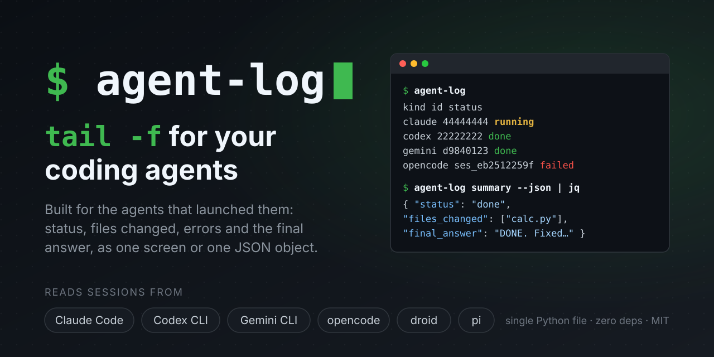
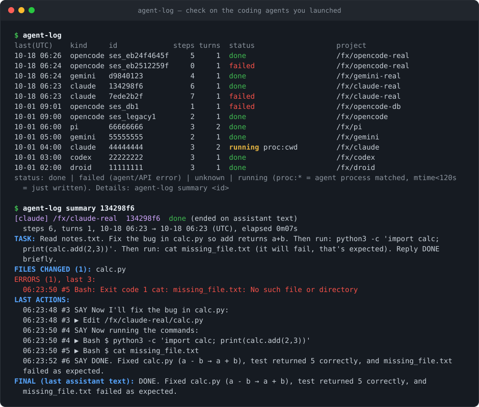

<p align="center">
  
</p>

<h1 align="center">agent-log</h1>

<p align="center">
  <b>给编程 agent 用的 <code>tail -f</code>，专为把活交给它们的常驻个人 agent 而做。</b><br>
  在脚本里查看 Claude Code、Codex CLI、Gemini CLI、opencode、droid 和 pi 的会话：<br>
  一屏文字或一个 JSON 对象，包含状态、改动的文件、错误和最终回答。
</p>

<p align="center">
  <a href="https://github.com/psylch/agent-log/actions/workflows/ci.yml"></a>
  
  <a href="LICENSE"></a>
  
  <a href="#支持的-agent"></a>
</p>

<p align="center"><a href="README.md">English</a> | <b>简体中文</b></p>

<p align="center">
  
</p>

## 给谁用

**主要用户：有自己运行环境、一直在线的个人 agent。**
比如 Grok Bot，以及其他跑在一台常驻机器或 shell 上的个人 agent。
这类 agent 经常把写代码之类的长任务交给装在同一台机器上的命令行编程 agent
（droid、Codex CLI、Claude Code、Gemini CLI、opencode 或 pi），让它在后台跑，自己先去忙别的。
之后它需要回答三个问题，又不可能一直盯着终端：还在跑吗？改了什么？有没有出错？
agent-log 用一屏文字或一个 JSON 对象给出答案。

一个典型场景：你让个人 agent 修好仓库里一个挂掉的测试。
它在自己的机器上后台启动 `droid exec "fix the failing test"`，然后先回复你。
二十分钟后你问“怎么样了？”，它运行 `agent-log summary latest --json`，
告诉你：已完成，改了 3 个文件，没有报错，再附上 droid 的最终回答。
整个过程它不用翻几 MB 的原始会话日志，也不用开着终端盯着。

**其次也适合人自己用**：你在后台同时跑了几个命令行编程 agent，想快速看一眼每个的情况，不用来回切终端。

## 为什么需要它

你（或者你的个人 agent）在后台启动了几个编程 agent：`claude -p`、`codex exec`、`droid exec`。
接下来要回答三个问题：跑完了吗？改了什么？有没有出错？

每个 agent 都会写会话日志，但这些日志很难直接用：

- **太大。** 长任务会产生几 MB 的 JSONL，里面塞满工具输出、思考过程和元数据。
- **太散。** 它们藏在 `~/.claude/projects/-work-api/<uuid>.jsonl` 这类转义过的路径下，每个 agent 的目录结构都不一样。
- **格式各异。** 六个 agent 就是六种格式，而且版本之间还会变。
- **不告诉你状态。** 没有哪条记录会写“仍在运行”或“已完成”，只能从最后一条记录和进程表去推断。

**agent-log** 把它们全部读懂，用一屏文字或一个 JSON 对象给出答案：
任务、状态（`running`、`done`、`failed`、`unknown`）、改动的文件、错误、最近的动作和最终回答。
它是一个零依赖的单文件 Python 程序，只读日志，从不写入，也从不联网。

## 安装

需要 Python 3.9 或更新版本，支持 Linux 和 macOS。任选一种：

```sh
pipx install agent-log-cli
uv tool install agent-log-cli
uvx agent-log-cli                              # 不安装，直接跑一次
```

从 git 安装（装完命令仍是 `agent-log`）：

```sh
pipx install git+https://github.com/psylch/agent-log
uv tool install git+https://github.com/psylch/agent-log
uvx --from git+https://github.com/psylch/agent-log agent-log
```

或者直接复制这个单文件，它没有任何依赖：

```sh
mkdir -p ~/.local/bin
curl -fsSL https://raw.githubusercontent.com/psylch/agent-log/master/agent_log.py -o ~/.local/bin/agent-log
chmod +x ~/.local/bin/agent-log
```

> [!NOTE]
> 命令名是 `agent-log`。PyPI 包名是 `agent-log-cli`，因为 PyPI 上的 `agent-log` 是另一个无关项目——
> `pip install agent-log` 会装错。

如果要读取 Codex 归档的 `.jsonl.zst` 会话，需要装 `zstd` 命令或 `zstandard` Python 包，否则这些归档会被跳过。

### 不装任何 agent 也能试

仓库里带有六种 agent 的脱敏会话。下面的命令用它们搭一个临时的 `$HOME`：

```sh
git clone https://github.com/psylch/agent-log && cd agent-log
python3 examples/demo_home.py /tmp/agent-log-demo
export HOME=/tmp/agent-log-demo AGENT_LOG_PROC=/tmp/agent-log-demo/.proc
python3 agent_log.py
python3 agent_log.py summary 134298f6
```

本文中的所有输出都来自这个演示目录，并设置了 `AGENT_LOG_TZ=UTC`。

## 快速上手

```sh
agent-log                                   # 所有 agent 的最近会话，最新的在前
agent-log list --active                     # 只看正在运行的
agent-log summary                           # 用一屏总结最新的会话
agent-log summary 134298f6                  # 指定会话：id 前缀、项目路径子串或会话文件路径
agent-log tail -f                           # 实时跟踪最新的会话（Ctrl-C 退出）
agent-log summary 134298f6 --json | jq -r .status
```

`agent-log summary 134298f6`，一个真实的 Claude Code 会话：

```text
[claude] /fx/claude-real  134298f6  done (ended on assistant text)
  steps 6, turns 1, 10-18 06:23 → 10-18 06:23 (UTC), elapsed 0m07s
TASK: Read notes.txt. Fix the bug in calc.py so add returns a+b. Then run: python3 -c 'import calc; print(calc.add(2,3))'. Then run: cat missing_file.txt (it will fail, that's expected). Reply DONE briefly.
FILES CHANGED (1): calc.py
ERRORS (1), last 3:
  06:23:50 #5 Bash: Exit code 1 cat: missing_file.txt: No such file or directory
LAST ACTIONS:
  06:23:48 #3 SAY Now I'll fix the bug in calc.py:
  06:23:48 #3 ▶ Edit /fx/claude-real/calc.py
  06:23:50 #4 SAY Now running the commands:
  06:23:50 #4 ▶ Bash $ python3 -c 'import calc; print(calc.add(2,3))'
  06:23:50 #5 ▶ Bash $ cat missing_file.txt
  06:23:52 #6 SAY DONE. Fixed calc.py (a - b → a + b), test returned 5 correctly, and missing_file.txt failed as expected.
FINAL (last assistant text): DONE. Fixed calc.py (a - b → a + b), test returned 5 correctly, and missing_file.txt failed as expected.
```

几个 `jq` 用法：

```sh
# 现在有哪些在跑，在哪个目录
agent-log list --json | jq -r '.sessions[] | select(.status == "running") | "\(.source) \(.session_id[:8]) \(.cwd)"'
# claude 44444444 /fx/claude

# 一个会话的精简版
agent-log summary 134298f6 --json | jq '{status, files_changed, error_count, final_answer}'

# 为什么失败了？
agent-log summary 7ede2b2f --json | jq -r '.errors[-1].text'
```

## 支持的 agent

| Agent | `--source` | 读取位置 | 原生环境变量 | 测试依据 |
|---|---|---|---|---|
| [Claude Code](https://github.com/anthropics/claude-code) | `claude` | `~/.claude/projects/<escaped-cwd>/<id>.jsonl` | `CLAUDE_CONFIG_DIR` | 真实会话（2.1） |
| [Codex CLI](https://github.com/openai/codex) | `codex` | `~/.codex/sessions/**/*.jsonl`、`~/.codex/archived_sessions/**`（含 `.jsonl.zst`） | `CODEX_HOME` | 真实会话 |
| [Gemini CLI](https://github.com/google-gemini/gemini-cli) | `gemini` | `~/.gemini/tmp/<project>/chats/session-*.jsonl`（0.6x）或 `session-*.json`（旧版） | 无 | 真实会话（0.64） |
| [opencode](https://github.com/anomalyco/opencode) | `opencode` | `~/.local/share/opencode/opencode*.db`（SQLite，只读打开）及旧版 `storage/` JSON 目录 | `XDG_DATA_HOME` | 真实会话（1.19） |
| [droid](https://factory.ai)（Factory） | `droid` | `~/.factory/sessions/<escaped-cwd>/<id>.jsonl` | 无 | 真实会话 |
| [pi](https://github.com/earendil-works/pi) | `pi` | `~/.pi/agent/sessions/--<cwd>--/<ts>_<id>.jsonl` | `PI_CODING_AGENT_DIR`、`PI_CODING_AGENT_SESSION_DIR` | 真实会话 |

任何 agent 都可以用 `AGENT_LOG_HOME_<AGENT>` 指到别的目录，例如 `AGENT_LOG_HOME_CODEX=/data/codex`。

没有你用的 agent？[提需求](https://github.com/psylch/agent-log/issues/new?template=new_agent_support.yml)，或者[自己加一个](CONTRIBUTING.md#adding-a-new-agent)。最小的 provider（droid）只有 35 行左右。

## 命令

```text
agent-log list    [--active] [--since WHEN] [-n N] [--source NAME] [--project SUBSTR] [--json]
agent-log summary [SESSION] [--source NAME] [--project SUBSTR] [--json]
agent-log show    [SESSION] [--last N] [--since WHEN] [--until WHEN] [--turn N]
                  [--with-output] [--no-thinking] [--full] [--max-chars N] [-f] [--json]
agent-log tail    [SESSION] ...参数同 show；默认只显示最后 20 步，除非指定窗口或 --all
```

- **SESSION**：`latest`（默认）、id 前缀、项目路径的子串，或会话文件路径。opencode 数据库里的会话写作 `<db>#<session-id>`。
- **WHEN**：`30m`、`2h`、`1d`（多久以前）、`HH:MM`（今天），或 ISO 8601 日期/时间。
- 一个 **step** 是一条 assistant 消息（文字、思考和工具调用）；每个用户 prompt 开启一个新的 **turn**。

### 状态

| `status` | 含义 | `status_reason` |
|---|---|---|
| `running` | 匹配到存活的 agent 进程；或者会话文件在 120 秒内被写过，且该 agent 有进程存活 | `proc:session-id`、`proc:cwd`、`mtime<120s` |
| `done` | 已空闲，最近一轮以最终消息或 assistant 文字结束 | `final`、`ended on assistant text` |
| `failed` | 已空闲，最后一个事件是 agent/API 级错误（如 HTTP 403），而不是某个工具调用失败 | `ended on agent/API error` |
| `unknown` | 已空闲，其他情况：被杀、崩溃、停在工具调用上，或者是空会话 | `idle, ended on <kind>`、`no events` |

### 退出码

`0` 成功（`list` 没匹配到也返回 0，并会提示）；`1` `summary`/`show`/`tail` 找不到会话；`2` 用法错误；`130` 被 Ctrl-C 中断。

## JSON 输出

所有命令都支持 `--json`，输出面向程序，并保持稳定：

> **稳定性承诺**：每个对象都带 `"schema_version": 1`。任何版本都可能新增字段；
> 在 `schema_version` 仍为 1 时，已有字段的名字、类型和含义不变。重命名或删除字段会提升版本号。

时间戳都是带时区偏移的 ISO 8601。所有字段始终存在，未知值为 `null` 或 `[]`。

`summary --json` 返回一个会话对象：

| 字段 | 类型 | 含义 |
|---|---|---|
| `schema_version` | int | `1` |
| `source` | string | `claude`、`codex`、`gemini`、`opencode`、`droid` 或 `pi` |
| `session_id` | string | agent 自己的会话 id |
| `path` | string | 会话文件（opencode 数据库为 `<db>#<id>`） |
| `cwd` | string 或 null | agent 运行时所在的项目目录 |
| `status` / `status_reason` | string | 状态及原因，见上表 |
| `started` / `updated` | string 或 null | 第一个事件的时间 / 会话最后一次写入的时间 |
| `steps` / `turns` | int | assistant 消息数 / 用户 prompt 数 |
| `task` | string 或 null | 第一条 prompt，最多 600 字符 |
| `files_changed` | [string] | 被 edit、write、patch 类工具写过的路径，按首次出现排序；结果本身报错的编辑不算 |
| `error_count` | int | 全部错误数 |
| `errors` | [{`ts`, `tool`, `text`}] | 最近 10 个错误（失败的工具结果和 agent 错误）；agent 错误的 `tool` 为 null |
| `last_actions` | [{`ts`, `kind`, `text`}] | 最近 6 个工具调用（`tool_call`）和消息（`say`） |
| `final_answer` | string 或 null | 最近一轮的最终消息；会话空闲时取最后一段 assistant 文字；一轮仍在进行时为 null |

`list --json` 返回 `{"schema_version": 1, "sessions": [...]}`，每项包含上面除 `error_count`、`errors`、`last_actions`、`final_answer` 以外的字段。
`show --json` / `tail --json` 返回 `{"schema_version": 1, "session": {...}, "events": [...]}`，每个事件有 `ts`、`kind`、`tool`、`text`、`paths`、`step`、`turn`。
完整示例和事件字段说明见[英文 README](README.md#json-output)。

## 与编排器配合

agent-log 回答的正是编排器反复要问的问题：*跑完了吗？结果如何？* 下面的例子用到 [`examples/`](examples) 目录，需要 `agent-log` 和 `jq` 在 `PATH` 里。

### 1. 后台启动、轮询、决策

Claude Code 允许预先指定会话 id，这样查找最准确：

```sh
id=$(python3 -c 'import uuid; print(uuid.uuid4())')
claude -p --session-id "$id" "Fix the failing tests" > /dev/null 2>&1 &
pid=$!

until agent-log summary "$id" --json > /dev/null 2>&1; do sleep 5; done   # 等它第一次写入
examples/wait-for-agent.sh "$id"                                          # 每 30 秒查一次，结束后打印 summary JSON
```

没有会话 id 参数的 agent：在项目目录里找启动之后写入的最新会话。

```sh
start=$(date -u +%Y-%m-%dT%H:%M:%SZ)
codex exec --full-auto "Bump the dependencies" > /dev/null 2>&1 &
pid=$!
until id=$(agent-log list --source codex --project "$(pwd -P)" --since "$start" -n 1 --json |
           jq -re '.sessions[0].session_id // empty'); do sleep 5; done
examples/wait-for-agent.sh "$id" --source codex
```

[`wait-for-agent.sh`](examples/wait-for-agent.sh) 的退出码：`done` 为 `0`，`failed` 或 `unknown` 为 `1`；
会话仍标记为 running、但 `STALL` 秒（默认 600）内没有任何写入时为 `3`。这时由编排器决定是中断（`kill "$pid"`）还是继续等。

### 2. agent 结束时通知你

[`notify-on-done.sh`](examples/notify-on-done.sh) 运行 agent，找到它创建的会话，并在退出时发送 summary。可以用来唤醒编排器、聊天 bot 或你自己：

```sh
examples/notify-on-done.sh claude -p "Fix the failing tests"          # 结束时打印 summary JSON（附带 exit_code）

NOTIFY_URL=https://example.com/hooks/agents \
NOTIFY_JQ='{text: "\(.source) \(.status): \(.final_answer // "no final answer")"}' \
  examples/notify-on-done.sh codex exec --full-auto "Bump the dependencies" &   # POST 到 webhook

NOTIFY_CMD='my-bot wake --stdin' examples/notify-on-done.sh droid exec "Add a CHANGELOG entry" &
```

### 3. 教你的 agent 使用它

把 [`examples/skill/SKILL.md`](examples/skill/SKILL.md) 交给负责编排的 agent。Claude Code 可以把它复制到 `~/.claude/skills/agent-log/SKILL.md`；
不支持 skill 的 agent，可以把同样的内容放进 `AGENTS.md`、`CLAUDE.md` 或 `GEMINI.md`。

### 4. MCP

目前还没有 MCP server。能执行 shell 命令的 agent 现在就能直接用 CLI，`--json` 也让输出足够小。MCP server 在[路线图](#路线图)里，需要的话欢迎在 issue 里留言。

## 为什么不用 X？

已经有不少读 agent 会话的好工具，大多是给人回看历史用的。agent-log 面向的是“程序此刻要检查一次运行”。

| 工具 | 擅长 | 输出 | 形态 |
|---|---|---|---|
| **agent-log** | 从脚本或另一个 agent 回答“跑完没、改了啥、哪里错了” | 一屏文字或一个带状态的 JSON 对象 | 单个 Python 文件，只用标准库，无索引、无常驻进程 |
| [cass](https://github.com/Dicklesworthstone/coding_agent_session_search) | 跨多个 agent 搜索全部历史会话 | TUI，另有面向 agent 的 JSON robot 模式 | Rust 程序，带搜索索引 |
| [SpecStory CLI](https://github.com/specstoryai/getspecstory) | 把 AI 对话保存成可搜索的 Markdown | `.specstory/history/*.md`，可选云同步 | Go 程序 |
| [Agent Sessions](https://github.com/jazzyalex/agent-sessions) | 用图形界面浏览、搜索、恢复会话 | 桌面应用 | macOS 原生应用 |
| [ccusage](https://github.com/ccusage/ccusage) | token 用量和费用 | 用量报表 | `npx ccusage` |
| 直接 `tail -f` + `jq` | 什么都行，前提是你自己写 | 原始记录，每个 agent、每个版本都不一样 | 系统自带 |

搜索历史用 cass 或 SpecStory，看费用用 ccusage，脚本需要一个状态时用 agent-log，它们可以并存。
agent-log 故意做得很小：不用配置、不建索引、除了可选缓存什么都不存，bot 每 30 秒调用一次也没负担。

## 常见问题与限制

**这些 agent 的格式都没有公开文档，会不会坏？**
会，偶尔。agent-log 用当前版本的真实会话和旧格式的合成会话做测试；一条坏记录不会让整个会话读不出来。如果某次 agent 升级后解析出错，请[提 issue](https://github.com/psylch/agent-log/issues/new?template=bug_report.yml)。你自己的脚本有 JSON 的 `schema_version` 保护。

**它怎么知道 agent 还在运行？**
它在 `/proc`（Linux）或通过 `ps` 和 `lsof`（macOS）查找存活的 agent 进程，也能识别 `node`、`bun`、`deno` 包装的进程。命令行里带会话 id 的进程（`--session-id`、`resume <id>` 等）直接认领该会话；否则认领同一 agent 中项目目录与进程工作目录一致的最新会话。兜底规则：120 秒内写过的会话算作运行中，但前提是该 agent 有进程存活。这些都是启发式规则：

- 同一目录里跑同一个 agent 的两个会话时，先匹配最新的。agent 支持时请传会话 id（如 `claude --session-id`），结果才准确。
- 一次运行刚结束时，如果同一 agent 还有别的进程（比如另一个终端里的交互式 `claude`），这个会话最多会有两分钟显示 `running (mtime<120s)`。[`notify-on-done.sh`](examples/notify-on-done.sh) 知道进程已退出，所以不受影响。
- 如果 agent 跑在别的容器或机器上，agent-log 看不到它的进程。把 `AGENT_LOG_PROC` 设成一个不存在的路径，就只用“最近写入”来判断。

**为什么 Codex 会话看不到思考过程？**
Codex 的大部分推理内容是加密存储的。agent-log 只能显示 Codex 以明文保存的推理摘要（如果有的话）。

**会把我的数据发到别处吗？**
不会。agent-log 只读本地文件，从不建立网络连接，也从不修改会话文件（opencode 数据库以只读方式打开）。它唯一会写的是 `~/.cache/agent-log` 下给 `list` 用的小缓存（权限 0600），里面有每个会话的 id、项目路径、第一条 prompt 和改动的文件名。用 `--no-cache` 或 `AGENT_LOG_NO_CACHE=1` 可以关闭。

**它是编排器吗？**
不是。claude-squad、vibe-kanban 或你自己的 bot 负责启动和管理 agent，agent-log 只负责汇报，所以能和它们一起用。

**Windows？**
没有测试过。CI 只在 Linux 和 macOS 上跑。

## 路线图

只是想法，不是承诺。欢迎讨论和 PR。

- MCP server，把 `list` 和 `summary` 暴露成工具
- `watch` 命令：等待会话结束（目前由 `examples/wait-for-agent.sh` 完成）
- PyPI 和 Homebrew 包
- 更多 agent：Cursor CLI、Copilot CLI、Aider、Qwen Code、Amp

## 参与贡献

欢迎报 bug、适配 agent 新版本、增加新 agent。开发环境、fixture 脱敏规则和新增 agent 的步骤见 [CONTRIBUTING.md](CONTRIBUTING.md)。

```sh
python3 -m unittest discover -s tests
```

## 致谢

会话格式的知识来自 [SpecStory CLI](https://github.com/specstoryai/getspecstory)（Apache-2.0），仅作为格式参考，没有复制代码：agent-log 是独立的 Python 实现。

## 许可证

[MIT](LICENSE)
